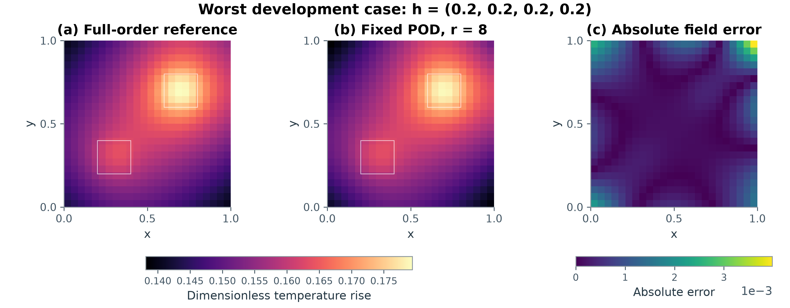

# Moonshine Thermal Lab

两处热源固定在一块板上。反复改变四条边的散热强度，怎样快速算出温度场，又能知道哪一次预测需要重算？

Moonshine Thermal Lab 提供两种入口。**热仿真求解器**先用低维模型预测温度，误差上界超过目标时调用完整求解器，并用新解更新模型。**Moonshine 研究智能体**可以接收新的实验要求、编写并运行 Python，再根据结果继续研究。

[](https://github.com/orgyuanbao/MoonshineThermalLab/actions/workflows/tests.yml)



上图取自四条边散热都较弱的一组开发算例。前两张温度图看起来几乎相同，右图却显示误差集中在角点，已经超过 `0.001` 的目标。这正是求解器要检查的情况。

[快速开始](#快速开始) · [用智能体做新实验](#用智能体做新实验) · [七轮运行记录](MoonshineThermalLab/evidence/iterations.json) · [实验代码](MoonshineThermalLab/thermal/home/projects/thermal-rom/workspace/experiments/) · [使用手册](MoonshineThermalLab/README.md)

## 快速开始

先用现成的实验试一遍。下面以 **Windows + 64 位 Python 3.12** 为例。在准备存放项目的目录打开 PowerShell，依次运行下面的命令。首次下载和安装需要联网，之后可在本地复算，无需模型账号。

```powershell
git clone https://github.com/orgyuanbao/MoonshineThermalLab.git thermal-lab
cd .\thermal-lab\MoonshineThermalLab
.\安装环境.cmd
.\.venv\Scripts\python.exe -B -X utf8 .\reproduce_thermal.py
```

如果已经下载并解压了仓库，请在含有 `安装环境.cmd` 的子目录打开 PowerShell，从安装命令开始执行。

这会在 24 × 24 网格上重新计算 256 组散热参数，并逐次比对温度误差和自适应更新记录。成功时终端最后一行会显示 `"status": "passed"`、`"model_calls": 0`、`"runs": 1` 和 `reproduction_report.json` 的完整路径。打开这个文件可查看比对次数及最大数值偏差。要复算全部三个网格、每个网格三次，在命令末尾加 `--full`。[复算程序](MoonshineThermalLab/reproduce_thermal.py) · [原始实验结果](MoonshineThermalLab/thermal/home/projects/thermal-rom/workspace/results/04_final_v1/summary.json)

## 用智能体做新实验

要让 Moonshine 编写代码、运行 Python 并根据输出继续研究，需在同一台电脑上安装 Codex CLI，登录有模型访问权限的账号。完成上面的环境安装后，在 `MoonshineThermalLab` 目录运行以下命令。

```powershell
.\启动热仿真研究.cmd
```

菜单按 `4` 选本机可用的模型，按 `1` 选择阶段。首次可以选阶段 `1`（建模与最小校验），直接回车使用预设任务。想给这道热仿真题增加一个实验，按 `5` 输入补充要求，例如“比较左右两边散热强度互换前后的最高温度”，另起一行输入 `END` 提交。每次推进一轮，按 `2` 查看进展，按 `3` 打开研究文件夹。

项目使用开源 Moonshine 的研究循环和工具，通过项目内的适配器调用模型。已归档的七轮运行使用 `gpt-6-astra`；其中第四轮首个模型请求超时，第五轮恢复同一会话并继续检验求解代码。[智能体入口](MoonshineThermalLab/thermal_agent.py) · [模型适配](MoonshineThermalLab/integration/codex_provider.py) · [上游 Moonshine](https://github.com/DeepMathLLM/Moonshine/tree/bb0e4aa025fdcc5297fff1025ab4876f120ed615) · [故障回执](MoonshineThermalLab/evidence/failed-calls.json)

## 什么时候值得用降阶模型？

两处热源固定，改变板的四条边的散热强度。以完整离散解为参照，温度场最大绝对误差目标取 `0.001`（无量纲温升）。下表采用同一序列的 256 组参数，分别在三个网格上运行。

| 网格 | 固定八维模型超标 | 自适应模型超标 | 256 次查询整体加速比 |
|---|---:|---:|---:|
| 24 × 24 | 6 / 256 | 0 / 256 | 4.46× |
| 48 × 48 | 6 / 256 | 0 / 256 | 5.29× |
| 96 × 96 | 7 / 256 | 0 / 256 | 5.39× |

加速比为快速完整求解耗时除以自适应方法耗时，计入训练、回退和更新，取三次配对计时的中位数。只算前 24 次查询时，三个网格的比值都约为 0.6，直接完整求解更快。自适应方法在三个网格分别触发了 15、15、17 次回退，而事后复核发现这些预测都已达标。数据反映这一算例及参数序列上的表现。[研究题面](MoonshineThermalLab/thermal/problem.md) · [实验说明](MoonshineThermalLab/README.md)

## 论文与演示

应用数学课程项目，徐楷沅（2352163）。最终选题为**基于 Moonshine 的变化散热边界热模型降阶与误差控制**，源自 EDA 专题的热仿真加速问题。[论文 PDF](MoonshineThermalLab/thermal/report/Moonshine_Thermal_Report.pdf) · [LaTeX 源码](MoonshineThermalLab/thermal/report/main.tex)

课堂演示可将课堂目录中的三个文件下载到同一文件夹，放映 PPT 时在第 3 页进入互动演示，或直接用浏览器打开 HTML。[汇报 PPT](MoonshineThermalLab/classroom/Moonshine热仿真课堂汇报.pptx) · [备讲稿与操作截图](MoonshineThermalLab/classroom/备讲稿与研究总结.pdf) · [离线演示 HTML](MoonshineThermalLab/classroom/Moonshine现场演示.html)

早期的鸿蒙异步众包定位项目保留了独立的[项目归档](CROWDLOCATE_ARCHIVE.md)，可以在那里找到旧题的代码、实验和报告。
