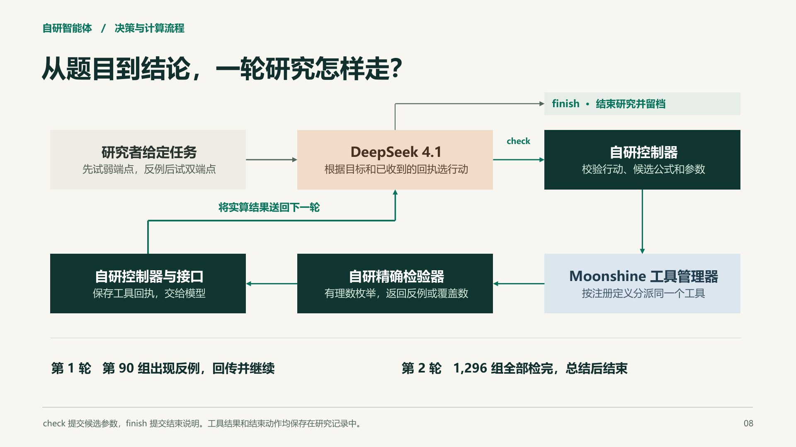

# Moonshine Thermal Lab

给定一张近似的温度图，误差最大的一格究竟会错多少？本项目开发了一个残差上界研究智能体。它提出一个候选上界，用精确分数找反例，读回真实误差并决定下一次检验。研究控制器和数学工具由项目实现，工具注册与执行复用开源 Moonshine。仓库还保留了早期 Moonshine 的推导、记录和三个大网格上的实际预测。

[](https://github.com/orgyuanbao/MoonshineThermalLab/actions/workflows/tests.yml)

[《人工智能与数学》课程论文 PDF](MoonshineThermalLab/course_paper/paper.pdf) · [课堂汇报 PPT](MoonshineThermalLab/classroom/Moonshine热仿真课堂汇报.pptx) · [自研智能体源码](MoonshineThermalLab/integration/bound_agent.py) · [两轮真实调用记录](MoonshineThermalLab/residual_study/agent_extension/live_trace.json) · [复算指南](START_HERE.md)

## 智能体是怎样开发的

项目先将四格导热问题写成可枚举的精确试验，再把它封装成工具 `check_residual_bound`。工具逐组比较真实误差和候选上界，返回首个反例或完成枚举的组数。我们用 Moonshine 的工具管理器注册和调用这个工具，并编写控制器保存每次调用的候选式、参数和结果。[数学检验工具](MoonshineThermalLab/integration/residual_tool.py) · [研究控制器](MoonshineThermalLab/integration/bound_agent.py)

我们还编写了模型适配器，把上一轮的工具结果连同原始目标交给 DeepSeek 4.1，由模型选择下一次检验或结束。在真实的两轮实验中，第二次仍使用同一个工具，只把候选式从 `weak_signed` 改为 `block_two_endpoint`。课堂汇报用流程图标出了这条反馈路径。[模型适配器](MoonshineThermalLab/integration/bound_agent_model.py) · [离线复核这两次运算](MoonshineThermalLab/residual_study/agent_extension/verify_live_trace.py)



## 运行残差上界研究智能体

进入 `MoonshineThermalLab` 子目录，首次使用先运行 `安装环境.cmd`。双击 `启动热仿真研究.cmd`，选 **8**，再回车，即可看见智能体依次检验原猜想、修正式和收紧后的倍数。终端逐轮显示精确值，并给出本次研究记录的位置。这一模式可以离线运行。[控制器](MoonshineThermalLab/integration/bound_agent.py) · [三轮实际记录](MoonshineThermalLab/residual_study/agent_extension/trace.json)

选 **8 → 2** 可让模型阅读每次反例并选择下一步。打开子目录里的 `.env`，填写 `LLM_BASE_URL`、`LLM_API_KEY` 和 `LLM_MODEL`。从 GitHub 克隆时可先把 `.env.example` 复制为 `.env`。接口采用支持工具调用的 Chat Completions 协议，模型选择检验，矩阵求解与分数比较在本机执行。[空白配置模板](MoonshineThermalLab/.env.example) · [模型接口和命令行示例](MoonshineThermalLab/README.md#运行自研残差上界研究智能体)

一次通过阿里云百炼运行的研究展示了这个循环。我们要求 **DeepSeek 4.1** 先检验弱端点公式，遇到反例再检验双端点公式。第 90 组中，真实误差为 399/538，超过原式给出的 21/46。模型读到这条工具结果后，提交了双端点公式；本机检查同一有限域中的全部 1,296 组，未发现反例。公开记录保留了原任务、两个工具调用和模型的结束说明。[两轮模型运行记录](MoonshineThermalLab/residual_study/agent_extension/live_trace.json) · [离线复核](MoonshineThermalLab/residual_study/agent_extension/verify_live_trace.py)

## 先试一个四格算例

同一块板、同一组散热条件，四个格子的残差都取 +1 时，最大温度误差等于 5.25；将符号按棋盘交错排列，误差降为 21/88，恰好小了 22 倍。两个例子的最大残差均为 1。用 Python 3.12 和标准库可以精确核对这两组数。

```powershell
git clone https://github.com/orgyuanbao/MoonshineThermalLab.git thermal-lab
cd .\thermal-lab\MoonshineThermalLab
python -B .\residual_study\exact_audit.py
```

成功时最后一行包含 `"error_ratio": "22"` 和 `"status": "passed"`。检查程序还会验证 17,496 组单元与分块的有理数区间，以及一个把带符号残差直接传入弱散热逆矩阵会低估误差的反例。[检验代码](MoonshineThermalLab/residual_study/exact_audit.py)

## 怎样用到实际预测

程序把残差按位置分成 4 × 4 块，读取每块的最小值和最大值，调用预计算的响应模板估计整张温度图的误差区间。若上界超过阈值，策略可以重做完整求解并用结果更新降阶模型。在 48 × 48 网格上，旧轨迹的第 11 个预测仅用位置得到的上界是 0.001022，加上正负后是 0.000926；阈值 0.001 刚好位于二者之间，该次实际误差约为 0.00000173。


三个网格各自使用相同的 256 个工况。固定旧预测做配对比较，原方法报警 47 次，分块符号界报警 29 次；独立部署并更新模型时，实际回退从 47 次降为 40 次，各方法的最终输出均达标。双端点界与单端符号界在这些实际预测上数值相同，增加端点模板后总耗时在本机三个网格上均未下降。[五种方法的实现](MoonshineThermalLab/residual_study/bounds.py) · [逐例数据与运行时间](MoonshineThermalLab/residual_study/results/)

## 复算全部数据，或让 Moonshine 做新实验

在上面进入的子目录，Windows 首次安装需要联网及 64 位 Python 3.12。安装后可离线完成以下数值复算。

```powershell
.\安装环境.cmd
.\.venv\Scripts\python.exe -B .\residual_study\run_experiment.py --check-against .\residual_study\results
.\.venv\Scripts\python.exe -B .\residual_study\fresh_stream.py
.\.venv\Scripts\python.exe -B .\residual_study\moonshine\replay.py
```

想让智能体继续研究，在已登录本机 Codex CLI 的环境中双击 `启动热仿真研究.cmd`，在主菜单选 **1**，再选研究阶段 **5**。可以补充自己的问题，例如「找一组同样大小、位置不同的残差，说明为什么某个上界会改变」。新一轮的工具回执和实验文件保存在本机。项目使用上游 Moonshine 的证明、反例搜索、审核和归档流程；本地实现题目入口、模型接入、会话恢复和证据保存。两轮原生研究分别进行了 2,592 和 1,968 组精确检查。11 月 21 日的课程论文和 PPT 由 Codex 依据归档材料整理。同一个 LaTeX 报告技能也可生成最终课程论文，把七轮先期记录、两轮残差研究、四格验证与三网格独立实验放入同一篇文章。[项目技能定义](MoonshineThermalLab/project_skills/latex-research-report/SKILL.md) · [自动报告与本轮证据](MoonshineThermalLab/report_example/)。[使用指南](MoonshineThermalLab/README.md) · [数学研究任务](MoonshineThermalLab/thermal/prompts/05_signed_residual.txt) · [上游源码](https://github.com/DeepMathLLM/Moonshine/tree/bb0e4aa025fdcc5297fff1025ab4876f120ed615)

## 论文与课堂演示

《人工智能与数学》课程论文（徐楷沅，2352163）给出误差界的推导、自研智能体与 DeepSeek 4.1 的两轮检验，以及大网格上的预测和部署实验。主菜单选 **7** 可从归档生成整篇论文。课堂 PPT 的演讲者备注解释了控制器、模型和数学工具各自完成的工作。[课程论文 PDF](MoonshineThermalLab/course_paper/paper.pdf) · [论文 LaTeX 源码](MoonshineThermalLab/course_paper/paper.tex) · [课堂汇报 PPT](MoonshineThermalLab/classroom/Moonshine热仿真课堂汇报.pptx) · [早期备讲稿](MoonshineThermalLab/classroom/备讲稿与研究总结.pdf) · [互动演示](MoonshineThermalLab/classroom/Moonshine现场演示.html)

论文采用的前期导热求解器、七轮研究记录和冻结输入均可查阅。[原导热实验](MoonshineThermalLab/thermal/home/projects/thermal-rom/workspace/results/04_final_v1/) · [七轮研究记录](MoonshineThermalLab/evidence/iterations.json)
