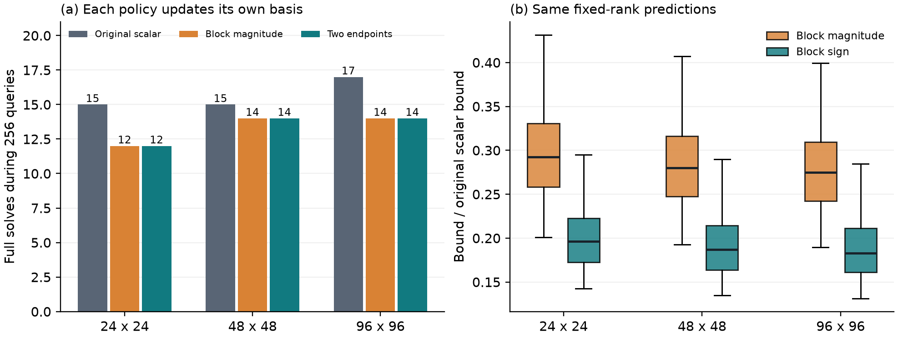

# Moonshine Thermal Lab

给定一张近似的温度图，怎样判断最不准确的那个格子究竟会错多少？Moonshine Thermal Lab 用二维稳态导热方程研究这一问题。这里可以复算同一组温度预测、检查每个误差上界，也可以启动开源 Moonshine，要求它推导一个命题、寻找反例并执行验证程序。

[](https://github.com/orgyuanbao/MoonshineThermalLab/actions/workflows/tests.yml)

[复算与开发指南](MoonshineThermalLab/residual_study/README.md) · [研究智能体](MoonshineThermalLab/thermal_agent.py) · [Moonshine 实际研究记录](MoonshineThermalLab/residual_study/moonshine/) · [最终课程论文 PDF](MoonshineThermalLab/course_paper/paper.pdf)

## 先试一个四格算例

同一块板、同一组散热条件，四个格子的残差都取 +1 时，最大温度误差等于 5.25；将符号按棋盘交错排列，误差降为 21/88，恰好小了 22 倍。两个例子的最大残差均为 1。用 Python 3.12 和标准库可以精确核对这两组数。

```powershell
git clone https://github.com/orgyuanbao/MoonshineThermalLab.git thermal-lab
cd .\thermal-lab\MoonshineThermalLab
python -B .\residual_study\exact_audit.py
```

成功时最后一行包含 `"error_ratio": "22"` 和 `"status": "passed"`。检查程序还会验证 17,496 组单元与分块的有理数区间，以及一个把带符号残差直接传入弱散热逆矩阵会低估误差的反例。[检验代码](MoonshineThermalLab/residual_study/exact_audit.py)

## 怎样用到实际预测

程序把残差按位置分成 4 × 4 块，读取每块的最小值和最大值，调用预计算的响应模板估计整张温度图的误差区间。若上界超过阈值，策略可以重做完整求解并用结果更新降阶模型。在 48 × 48 网格上，旧轨迹的第 11 个预测仅用位置得到的上界是 0.001022，加上正负后是 0.000926；阈值 0.001 刚好位于二者之间，该次实际误差约为 0.00000173。



三个网格各自使用相同的 256 个工况。固定旧预测做配对比较，原方法报警 47 次，分块符号界报警 29 次；独立部署并更新模型时，实际回退从 47 次降为 40 次，各方法的最终输出均达标。双端点界与单端符号界在这些实际预测上数值相同，增加端点模板后总耗时在本机三个网格上均未下降。[五种方法的实现](MoonshineThermalLab/residual_study/bounds.py) · [逐例数据与运行时间](MoonshineThermalLab/residual_study/results/)

## 复算全部数据，或让 Moonshine 做新实验

在上面进入的子目录，Windows 首次安装需要联网及 64 位 Python 3.12。安装后可离线完成以下数值复算。

```powershell
.\安装环境.cmd
.\.venv\Scripts\python.exe -B .\residual_study\run_experiment.py --check-against .\residual_study\results
.\.venv\Scripts\python.exe -B .\residual_study\fresh_stream.py
.\.venv\Scripts\python.exe -B .\residual_study\moonshine\replay.py
```

想让智能体继续研究，在已登录本机 Codex CLI 的环境中双击 `启动热仿真研究.cmd`，在主菜单选 **1**，再选研究阶段 **5**。可以补充自己的问题，例如「找一组同样大小、位置不同的残差，说明为什么某个上界会改变」。新一轮的工具回执和实验文件保存在本机。项目使用上游 Moonshine 的证明、反例搜索、审核和归档流程；本地实现题目入口、模型接入、会话恢复和证据保存。两轮原生研究分别进行了 2,592 和 1,968 组精确检查。11 月 21 日的课程论文和 PPT 由 Codex 依据归档材料整理。同一个 LaTeX 报告技能也可生成最终课程论文，把七轮先期记录、两轮残差研究、四格验证与三网格独立实验放入同一篇文章。[项目技能定义](MoonshineThermalLab/project_skills/latex-research-report/SKILL.md) · [自动报告与本轮证据](MoonshineThermalLab/report_example/)。[使用指南](MoonshineThermalLab/README.md) · [数学研究任务](MoonshineThermalLab/thermal/prompts/05_signed_residual.txt) · [上游源码](https://github.com/DeepMathLLM/Moonshine/tree/bb0e4aa025fdcc5297fff1025ab4876f120ed615)

## 论文与课堂演示

徐楷沅（2352163）的最终论文从残差方程出发，推导误差界，再用相同预测和独立运行两种实验检验它。安装项目环境后，在研究菜单选 **7** 可从归档证据生成整篇论文，无需登录模型。课堂放映用同目录的 PPT、HTML 和四格报告 PDF。[最终课程论文 PDF](MoonshineThermalLab/course_paper/paper.pdf) · [论文 LaTeX 源码](MoonshineThermalLab/course_paper/paper.tex) · [本次生成回执](MoonshineThermalLab/course_paper/receipt.json) · [可编辑 PPT](MoonshineThermalLab/classroom/Moonshine热仿真课堂汇报.pptx) · [讲稿](MoonshineThermalLab/classroom/备讲稿与研究总结.pdf) · [互动演示](MoonshineThermalLab/classroom/Moonshine现场演示.html)

前一期的导热求解器、原七轮记录和冻结输入均可查阅。更早的鸿蒙众包定位项目另有归档。[原导热实验](MoonshineThermalLab/thermal/home/projects/thermal-rom/workspace/results/04_final_v1/) · [原七轮记录](MoonshineThermalLab/evidence/iterations.json) · [上一版导热论文](https://github.com/orgyuanbao/MoonshineThermalLab/blob/ef9273d2a64242344af26b609807e5249172b565/MoonshineThermalLab/thermal/report/Moonshine_Thermal_Report.pdf) · [众包定位归档](CROWDLOCATE_ARCHIVE.md)
